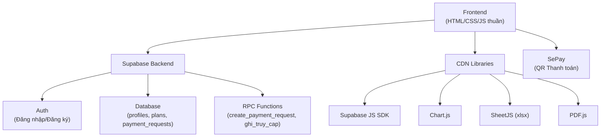

# 📋 Hướng Dẫn Clone & Thiết Lập Dự Án HadaPlus Tool

## ✅ Trạng thái tải về

Toàn bộ frontend đã được tải về thành công tại: [hadaplus-clone](file:///d:/Github/ShopeeTiktokAny/hadaplus-clone)

| File | Kích thước | Mô tả |
|------|-----------|-------|
| [index.html](file:///d:/Github/ShopeeTiktokAny/hadaplus-clone/index.html) | 972KB | Trang chính - toàn bộ tool (14.500+ dòng) |
| [login.html](file:///d:/Github/ShopeeTiktokAny/hadaplus-clone/login.html) | 28KB | Trang đăng nhập/đăng ký |
| [admin.html](file:///d:/Github/ShopeeTiktokAny/hadaplus-clone/admin.html) | 84KB | Trang quản trị (duyệt user, quản lý hạn) |
| [images/](file:///d:/Github/ShopeeTiktokAny/hadaplus-clone/images) | ~3.3MB | 10 ảnh feedback + award |
| [robots.txt](file:///d:/Github/ShopeeTiktokAny/hadaplus-clone/robots.txt) | 73B | File robots |
| [sitemap.xml](file:///d:/Github/ShopeeTiktokAny/hadaplus-clone/sitemap.xml) | 271B | Sitemap |

## 🏗️ Kiến trúc dự án



## 🔧 Các bước thiết lập dự án riêng

### Bước 1: Tạo Supabase Project mới
1. Truy cập [supabase.com](https://supabase.com) → **New Project**
2. Chọn region gần VN (Singapore)
3. Lưu lại **Project URL** và **anon key**

### Bước 2: Tạo bảng Database

```sql
-- Bảng profiles (quản lý user)
CREATE TABLE profiles (
  id UUID PRIMARY KEY REFERENCES auth.users(id) ON DELETE CASCADE,
  approved BOOLEAN DEFAULT false,
  expires_at TIMESTAMPTZ,
  role TEXT DEFAULT 'member',
  created_at TIMESTAMPTZ DEFAULT now()
);

-- Bảng plans (bảng giá)
CREATE TABLE plans (
  id SERIAL PRIMARY KEY,
  months INTEGER NOT NULL,
  amount NUMERIC NOT NULL,
  label TEXT NOT NULL,
  note TEXT,
  sort INTEGER DEFAULT 0,
  active BOOLEAN DEFAULT true
);

-- Bảng payment_requests (yêu cầu thanh toán)
CREATE TABLE payment_requests (
  id SERIAL PRIMARY KEY,
  user_id UUID REFERENCES auth.users(id),
  code TEXT UNIQUE NOT NULL,
  months INTEGER NOT NULL,
  amount NUMERIC NOT NULL,
  paid_amount NUMERIC DEFAULT 0,
  status TEXT DEFAULT 'pending',
  buyer_type TEXT,
  buyer_name TEXT,
  buyer_company TEXT,
  buyer_tax_id TEXT,
  buyer_phone TEXT,
  buyer_address TEXT,
  buyer_id_no TEXT,
  buyer_email TEXT,
  created_at TIMESTAMPTZ DEFAULT now()
);

-- Dữ liệu mẫu bảng giá
INSERT INTO plans (months, amount, label, note, sort, active) VALUES
  (1, 99000, '1 Tháng', NULL, 1, true),
  (3, 249000, '3 Tháng', 'Phổ biến', 2, true),
  (6, 449000, '6 Tháng', NULL, 3, true),
  (12, 799000, '12 Tháng', 'Tiết kiệm nhất', 4, true);
```

### Bước 3: Tạo RPC Functions

```sql
-- Hàm ghi lượt truy cập
CREATE OR REPLACE FUNCTION ghi_truy_cap()
RETURNS void AS $$
BEGIN
  -- Logic ghi truy cập tùy theo nhu cầu
  NULL;
END;
$$ LANGUAGE plpgsql SECURITY DEFINER;

-- Hàm tạo mã thanh toán
CREATE OR REPLACE FUNCTION create_payment_request(p_months INTEGER, p_buyer JSONB)
RETURNS SETOF payment_requests AS $$
DECLARE
  v_code TEXT;
  v_amount NUMERIC;
  v_user_id UUID;
BEGIN
  v_user_id := auth.uid();
  SELECT amount INTO v_amount FROM plans WHERE months = p_months AND active = true LIMIT 1;
  v_code := 'HP' || EXTRACT(EPOCH FROM now())::BIGINT::TEXT || FLOOR(RANDOM() * 1000)::TEXT;
  
  RETURN QUERY
  INSERT INTO payment_requests (user_id, code, months, amount, buyer_type, buyer_name, 
    buyer_company, buyer_tax_id, buyer_phone, buyer_address, buyer_id_no, buyer_email)
  VALUES (v_user_id, v_code, p_months, v_amount,
    p_buyer->>'type', p_buyer->>'name', p_buyer->>'company', p_buyer->>'tax_id',
    p_buyer->>'phone', p_buyer->>'address', p_buyer->>'id_no', p_buyer->>'email')
  RETURNING *;
END;
$$ LANGUAGE plpgsql SECURITY DEFINER;
```

### Bước 4: Cập nhật thông tin Supabase

Thay thế trong **cả 3 file** (index.html, login.html, admin.html):

```diff
-const SUPABASE_URL = 'https://qotrwydgsnpqzvausldc.supabase.co';
-const SUPABASE_KEY = 'eyJhbGciOiJIUzI1NiIs...';
+const SUPABASE_URL = 'https://YOUR_PROJECT.supabase.co';
+const SUPABASE_KEY = 'YOUR_ANON_KEY';
```

### Bước 5: Cập nhật thông tin ngân hàng

Trong `index.html`, tìm và sửa:

```diff
-var GH_BANK = 'ACB';
-var GH_ACC  = '48870427';
-var GH_NAME = 'HO KINH DOANH TRUONG HAI DANG';
-var GH_ZALO = '0918657464';
+var GH_BANK = 'YOUR_BANK';
+var GH_ACC  = 'YOUR_ACCOUNT_NUMBER';
+var GH_NAME = 'YOUR_ACCOUNT_NAME';
+var GH_ZALO = 'YOUR_ZALO_NUMBER';
```

### Bước 6: Cập nhật URL redirect

Trong `login.html`, sửa URL redirect:

```diff
-emailRedirectTo: 'https://www.hadaplustool.vn/login.html'
+emailRedirectTo: 'https://YOUR_DOMAIN/login.html'
```

### Bước 7: Đổi branding

| Mục cần đổi | Vị trí |
|---|---|
| Tên thương hiệu | `<span class="hada">HADA</span><span class="plus">PLUS</span>` |
| Hotline | `Hotline: 0949.289.705` |
| Meta tags (title, description) | Phần `<head>` của index.html |
| Số Zalo hỗ trợ | Nhiều nơi trong index.html |
| Logo/favicon | Tạo file favicon.ico mới |
| Ảnh feedback | Thay ảnh trong thư mục `images/` |

### Bước 8: Deploy

> [!TIP]
> Vì đây là web tĩnh (HTML/CSS/JS), anh có thể deploy miễn phí lên:
> - **Vercel**: `npx vercel --prod`
> - **Netlify**: Kéo thả thư mục lên [app.netlify.com](https://app.netlify.com)
> - **GitHub Pages**: Push lên GitHub repo → Settings → Pages
> - **Cloudflare Pages**: Kết nối GitHub repo

## ⚠️ Lưu ý quan trọng

> [!CAUTION]
> - File `index.html` gốc có **Content-Security-Policy** giới hạn `connect-src` chỉ cho phép kết nối tới Supabase cũ. Anh cần cập nhật lại URL Supabase mới trong thẻ `<meta http-equiv="Content-Security-Policy">`.
> - RPC function `create_payment_request` cần được tạo chính xác vì nó xử lý thanh toán.
> - Hệ thống SePay (tự nhận diện thanh toán) cần anh đăng ký tài khoản SePay riêng nếu muốn dùng tính năng thanh toán tự động.

## 📁 Cấu trúc file hoàn chỉnh

```
hadaplus-clone/
├── index.html        ← Trang chính (dashboard + tất cả tool)
├── login.html        ← Trang đăng nhập/đăng ký  
├── admin.html        ← Trang quản trị
├── robots.txt
├── sitemap.xml
└── images/
    ├── fb1.jpg ~ fb9.jpg   ← Feedback khách hàng
    ├── award1.jpg ~ award3.jpg  ← Giải thưởng
    └── team.jpg            ← Ảnh team
```
